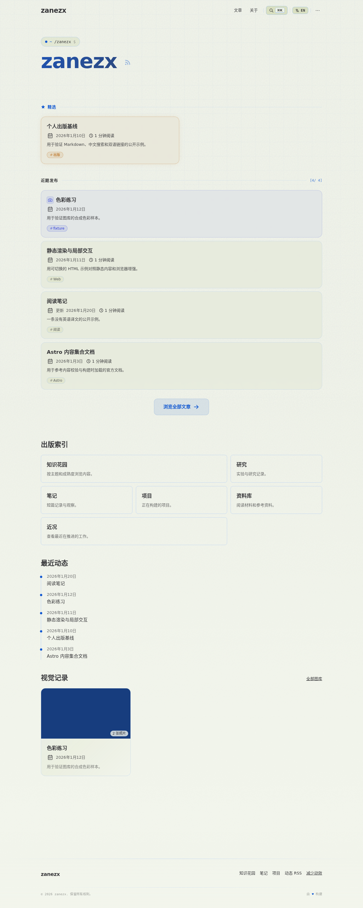

<div align="center">

# zanezx · Personal Publishing System

**An independent, bilingual Astro publication for essays, research notes, digital gardens, projects and visual records.**

[](https://github.com/izanezx/personal-publishing-system/actions/workflows/ci.yml)
[](LICENSE)
[](.node-version)
[](package.json)
[](wrangler.jsonc)
[](https://github.com/izanezx/personal-publishing-system)

A long-lived publishing system built from the Devosfera reading experience, enhanced with selected AstroPaper engineering practices, and maintained independently from both upstream projects.

[Features](#features) · [Project structure](#project-structure) · [Quick start](#quick-start) · [Content](#content-model) · [Commands](#commands) · [Deployment](#cloudflare-deployment) · [Agent setup](#agent-workflow)

</div>



> [!NOTE]
> The current candidate is deployed at `https://zanezx.com/` with `noindex, nofollow` until launch approval. The display name `zanezx`, public biography and launch content remain pending before the stable `v0.1.0` release.

## Features

- **Bilingual publishing:** Chinese at `/`, English at `/en/`, with translation-aware navigation and canonical URLs.
- **Editorial content model:** stable UIDs, permanent slugs, redirects, relationships, topics, maturity and exact publication time.
- **Multiple publishing formats:** essays and research articles, Notes, Projects, Library entries, Garden topics and Galleries.
- **Browser publishing:** Sveltia CMS saves Markdown directly to GitHub, then CI builds, deploys and verifies the production site automatically.
- **External media:** Cloudflare R2 stores editor uploads under the public `media.zanezx.com` origin.
- **Reading experience retained from Devosfera:** reading mode, search, table of contents, light and dark themes, gallery lightboxes and optional motion reduction.
- **Selected AstroPaper practices:** callouts, responsive tables, extension slots, shareable search, typed settings, safe JSON-LD and CJK-aware Open Graph images.
- **Static output:** Astro static generation, Pagefind search, RSS, activity feed, Sitemap, robots and dynamic social images.
- **Quality gates:** unit tests, Chromium end-to-end tests, accessibility-oriented interactions, performance budgets, root and subpath builds, and a Cloudflare promotion and rollback drill.
- **Reproducible agent workflow:** 38 vendored Skills, a content-hashed `skills-lock.json`, explicit MCP fallbacks and project instructions in [AGENTS.md](AGENTS.md).

## Tech stack

| Area            | Choice                                       |
| --------------- | -------------------------------------------- |
| Framework       | Astro 7 with TypeScript                      |
| Styling         | Tailwind CSS 4                               |
| Content         | Astro Content Collections, Markdown and MDX  |
| Search          | Pagefind 1.6                                 |
| Images          | Sharp, Satori and resvg                      |
| Browser tests   | Playwright                                   |
| Package manager | pnpm 10.28.0                                 |
| Runtime         | Node.js 24.22.3                              |
| Hosting         | Cloudflare Workers Static Assets             |
| Publishing      | Sveltia CMS, GitHub App and Simple Workflow  |
| Media           | Cloudflare R2                                |
| Release control | Verified CI artifacts and automatic rollback |

## Project structure

```text
.
├── .agents/skills/          # Reproducible project Skills for coding agents
├── .github/                 # CI, deployment and repository templates
├── docs/                    # Product, acceptance, release and owner guides
├── infra/                   # Sveltia authenticator and R2 configuration
├── public/                  # Static files, headers and favicon
├── scripts/                 # Build, search, release and Skill verification
├── src/
│   ├── components/          # Reader, navigation and editorial components
│   ├── data/
│   │   ├── blog/{zh-cn,en}/ # Essays and research
│   │   ├── galleries/       # Localized gallery metadata and media
│   │   └── pages/           # Localized About and Now pages
│   ├── i18n/                # Locale registry and interface strings
│   ├── layouts/             # Site, article, listing and Garden layouts
│   ├── lib/content/         # Identity, publication and relationship queries
│   ├── pages/               # Chinese root and English /en/ routes
│   ├── scripts/             # Progressive browser enhancements
│   └── styles/              # Global and article styles
├── tests/                   # Unit, browser and release tests
├── astro.config.ts
├── wrangler.jsonc
└── skills-lock.json
```

## Quick start

### Requirements

- Node.js `24.22.3`
- pnpm `10.28.0`

With Corepack:

```bash
corepack enable
git clone https://github.com/izanezx/personal-publishing-system.git
cd personal-publishing-system
pnpm install --frozen-lockfile
cp .env.example .env
pnpm dev
```

Open `http://localhost:4321`. Search requires a production build because Pagefind indexes the final static artifacts:

```bash
pnpm build
pnpm preview
```

### Use as a GitHub template

The repository is a GitHub public template. You can use **Use this template → Create a new repository** for a derivative project. Review [UPSTREAM_BASELINES.md](UPSTREAM_BASELINES.md), [THIRD_PARTY_NOTICES.md](THIRD_PARTY_NOTICES.md) and all third-party license files before redistributing a modified template.

## Configuration

The temporary public identity and optional integrations are configured in:

- `src/lib/site-settings.ts`: site URL, title, description, author, timezone and listing limits.
- `src/config.ts`: theme, sharing, edit links, motion and optional audio.
- `.env`: public social links and edit URL. Never commit `.env`.
- `src/data/pages/{zh-cn,en}/`: About and Now page content.
- `public/admin/config.yml`: Sveltia collections, simple workflow and R2 storage.

Owner-specific launch material is tracked in [docs/OWNER_CONTENT_CHECKLIST.md](docs/OWNER_CONTENT_CHECKLIST.md).

## Content model

Chinese posts live in `src/data/blog/zh-cn/`; English posts live in `src/data/blog/en/`. The schema is defined in `src/content.config.ts`.

Each publication has a stable identity independent of its folder and title:

```yaml
uid: publishing-baseline
slug: publishing-baseline
previousSlugs: []
translationKey: publishing-baseline
pubDatetime: 2026-01-10T09:00:00+08:00
kind: article
topics: [publishing]
stage: evergreen
```

When a public URL changes, append the old slug to `previousSlugs` so the static host can emit a permanent redirect. Draft and future content is excluded from routes, feeds, sitemap and search.

Read the [Chinese publishing guide](docs/PUBLISHING.zh-CN.md), [docs/PRODUCT.md](docs/PRODUCT.md), [ARCHITECTURE.md](ARCHITECTURE.md), and [GALLERIES.md](GALLERIES.md) for the complete content, maintenance and media rules.

## Commands

| Command                 | Action                                                     |
| ----------------------- | ---------------------------------------------------------- |
| `pnpm dev`              | Start the Astro development server                         |
| `pnpm build`            | Type-check, build the site and generate the Pagefind index |
| `pnpm preview`          | Preview the generated static output                        |
| `pnpm test`             | Run unit tests                                             |
| `pnpm lint`             | Run ESLint                                                 |
| `pnpm format:check`     | Verify Prettier formatting                                 |
| `pnpm cms:check`        | Validate Sveltia Schema, SRI, workflow and R2 shape        |
| `pnpm media:check`      | Reject media outside the site and R2 origins               |
| `pnpm test:e2e`         | Run the Playwright browser suite                           |
| `pnpm test:release`     | Rehearse preview policy, production responses and rollback |
| `pnpm candidate:create` | Package a build with commit and policy metadata            |
| `pnpm candidate:verify` | Reject a candidate whose commit, policy or files changed   |
| `pnpm smoke`            | Verify a deployed preview or production site               |
| `pnpm status:due`       | Check scheduled publication and expiration manifests       |
| `pnpm security:audit`   | Fail on high or critical dependency advisories             |
| `pnpm skills:check`     | Verify every vendored Skill against `skills-lock.json`     |

Before opening a pull request, run:

```bash
pnpm security:audit
pnpm skills:check
pnpm cms:check
pnpm test
pnpm lint
pnpm format:check
pnpm build
pnpm test:e2e
pnpm test:release
```

Subpath and deployment verification steps are in [docs/RELEASE.md](docs/RELEASE.md).

## Publishing and deployment

Open `https://zanezx.com/admin/` to create or edit content. Sveltia saves through
the simple workflow: unsaved edits are backed up in the browser, and Save
commits directly to `main`. There is no CMS review or pending-publication stage.
Editorial changes therefore use one step:

```text
Save -> main -> CI -> production deployment -> live smoke test
```

After the `main` CI succeeds, the production workflow:

1. downloads the exact production artifact built and tested by that CI run;
2. verifies its commit, mode, indexing policy and SHA-256 fingerprint;
3. records the active Cloudflare Worker Version and deploys `zanezx.com`;
4. runs live HTTP, route, RSS, Sitemap, search, Admin, 404, 410 and 301 checks;
5. rolls back automatically if verification fails.

Same-repository pull requests receive an isolated non-indexable preview at
`https://personal-publishing-system-preview.zanezx.workers.dev`.

The repository uses separate Environment Secrets for preview and production.
Current Variables are `CLOUDFLARE_ACCOUNT_ID`, `PREVIEW_URL` and
`PUBLIC_INDEXING_ENABLED`. The site remains `noindex, nofollow` until the owner
approves the first indexing launch.

Read:

- [Sveltia CMS 写作与发布](docs/SVELTIA.zh-CN.md)
- [Cloudflare R2 媒体存储](docs/MEDIA_R2.zh-CN.md)
- [账号配置](docs/ACCOUNT_SETUP.zh-CN.md)
- [Release and owner handoff](docs/RELEASE.md)

## Agent workflow

Project Skills are vendored under `.agents/skills/` and pinned by content hash. [AGENTS.md](AGENTS.md) maps each development activity to the Skills and repository checks that apply. [docs/AGENT_ENVIRONMENT.md](docs/AGENT_ENVIRONMENT.md) records upstream source revisions, MCP availability and documented fallbacks.

The project distinguishes:

- An **upstream commit** such as Matt Pocock's `abeeaf9`: the exact source revision recorded when a Skill was imported.
- A **project commit**: the independently maintained revision that becomes authoritative after import.

Known upstream sources are recorded. Vendoring and `skills-lock.json` make the repository copy reproducible even when an upstream moves, disappears or publishes incompatible changes.

## Maintenance and provenance

This repository has its own Git history and does not merge upstream development branches. Devosfera, AstroPaper and AstroWind are reviewed as read-only sources; relevant changes are adapted through normal issues and pull requests with tests.

- Devosfera `bba247e2`: licensed starting source and reader experience.
- AstroPaper `v7.2.0`: selected publishing and engineering practices.
- AstroWind `14e1a691`: selected component and agent workflow reference.

MIT copyright and provenance notices are retained in [LICENSE](LICENSE), [UPSTREAM_BASELINES.md](UPSTREAM_BASELINES.md) and [THIRD_PARTY_NOTICES.md](THIRD_PARTY_NOTICES.md). Operational independence does not remove the attribution required for distributed derivative code.

## Contributing

Read [CONTRIBUTING.md](CONTRIBUTING.md) and [AGENTS.md](AGENTS.md). Keep changes focused, link the relevant issue, update tests and documentation, and include every verification command you ran.

## Security

Report vulnerabilities privately through GitHub Security Advisories after private vulnerability reporting is enabled. See [SECURITY.md](SECURITY.md) and [docs/SECURITY_AUDIT.md](docs/SECURITY_AUDIT.md).

## License

Released under the [MIT License](LICENSE). Third-party fonts, Skills and imported source retain their own notices.
